

<a href="https://github.com/Tejaromalius">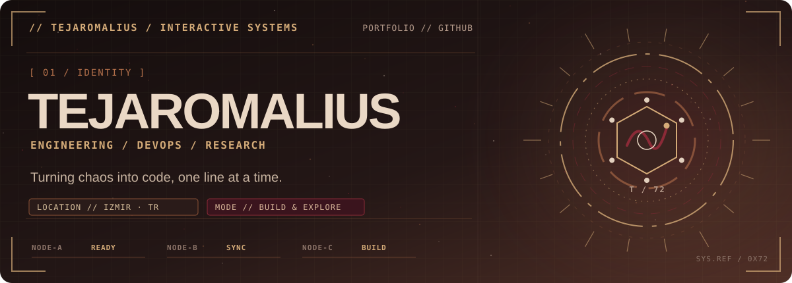</a>

### `> cat ./operator`

**Ilia Tayefi** · Full-stack engineering, .NET, DevOps and ML research · Izmir, Türkiye.

I build things, benchmark ideas, work on developer tooling, and occasionally make software just because the idea is entertaining. The engineering stack is below; repository-specific information is taken from GitHub rather than hand-written here.

### `> ls ./workspaces`

<table><tr>
<td width="33%"><a href="https://github.com/tejaromalius-labs">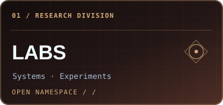</a></td>
<td width="33%"><a href="https://github.com/tejaromalius-contributes">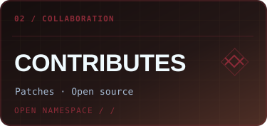</a></td>
<td width="33%"><a href="https://github.com/tejaromalius-snax">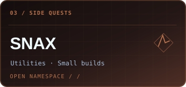</a></td>
</tr></table>

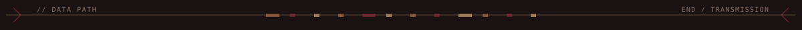

### `> query ./repository-registry --source=github.description`

<!-- REPOSITORY_REGISTRY:START -->

SOURCE / GITHUB REPOSITORY ABOUT → DESCRIPTION · REGENERATED BY GITHUB ACTIONS

#### `LABS / PUBLIC RESEARCH`

<table><tbody>
<tr>
<td width="50%" valign="top"><a href="https://github.com/tejaromalius-labs/Comprenchmark">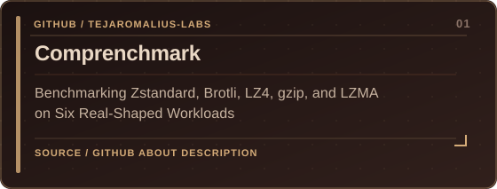</a></td>
<td width="50%" valign="top"><a href="https://github.com/tejaromalius-labs/BitonicBreaker">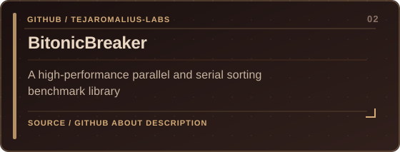</a></td>
</tr>
<tr>
<td width="50%" valign="top"><a href="https://github.com/tejaromalius-labs/CuckooFiltersBarcodes">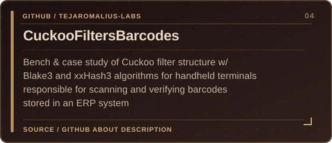</a></td>
<td width="50%"></td>
</tr>
</tbody></table>

#### `CONTRIBUTES / OPEN SOURCE`

<table><tbody>
<tr>
<td width="50%" valign="top"><a href="https://github.com/tejaromalius-contributes/Adaptive-Tab-Bar-Colour-Asus-Edition">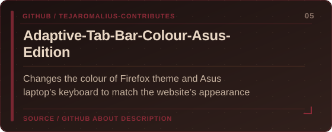</a></td>
<td width="50%"></td>
</tr>
</tbody></table>

#### `SNAX / SMALL BUILDS`

<table><tbody>
<tr>
<td width="50%" valign="top"><a href="https://github.com/tejaromalius-snax/PilotFan">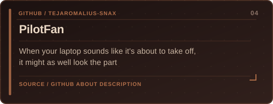</a></td>
<td width="50%" valign="top"><a href="https://github.com/tejaromalius-snax/SmartToDock">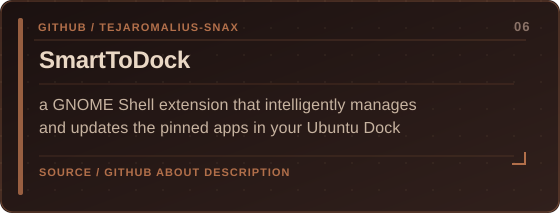</a></td>
</tr>
<tr>
<td width="50%" valign="top"><a href="https://github.com/tejaromalius-snax/Tigit">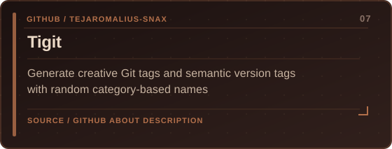</a></td>
<td width="50%" valign="top"><a href="https://github.com/tejaromalius-snax/Scribdify">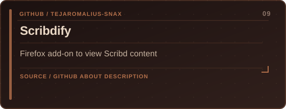</a></td>
</tr>
</tbody></table>
<!-- REPOSITORY_REGISTRY:END -->

### `> inspect ./toolchain --scope=operator`

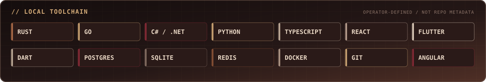

### `> ./outbound`

[**GitHub / Tejaromalius**](https://github.com/Tejaromalius) &nbsp;·&nbsp; [**LinkedIn**](https://www.linkedin.com/in/tayefi-ilia/) &nbsp;·&nbsp; [**Explore all repositories**](https://github.com/Tejaromalius?tab=repositories)

<a href="https://github.com/Tejaromalius">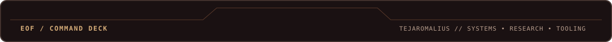</a>

